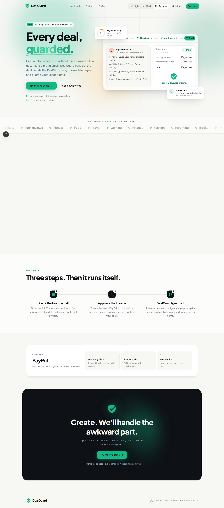
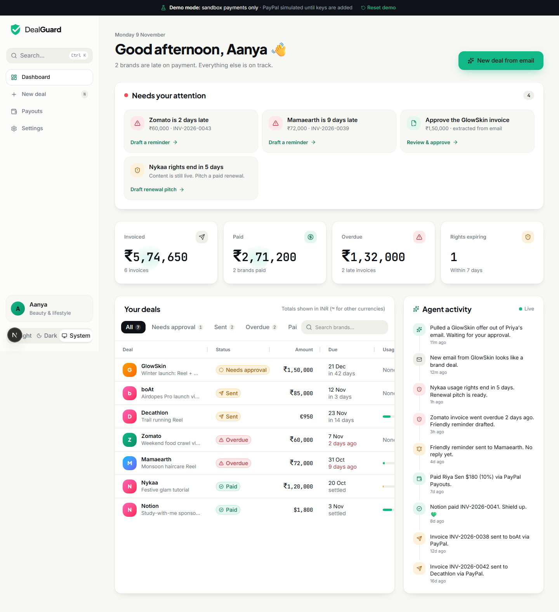
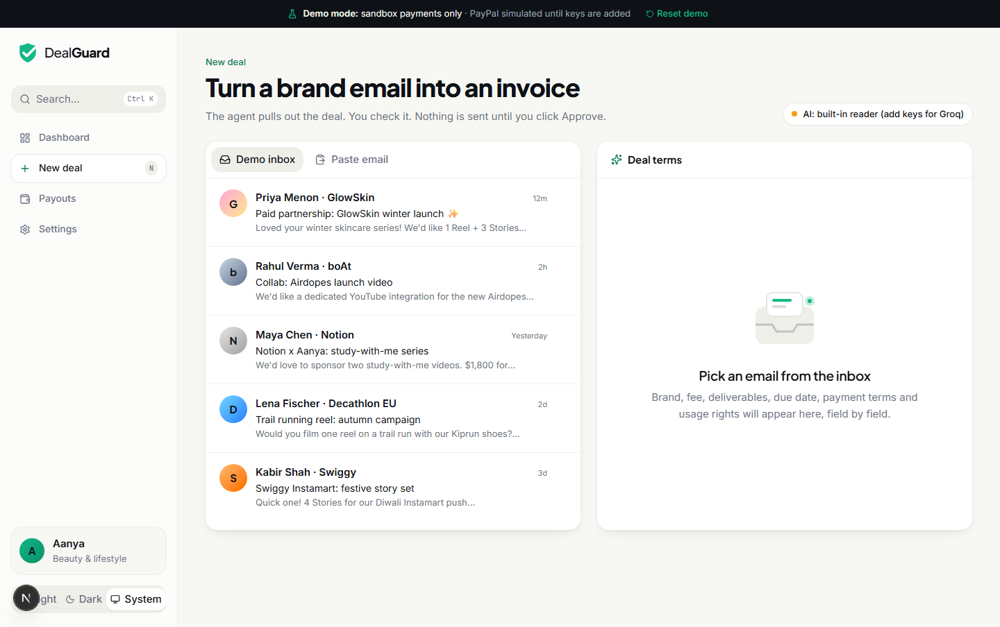
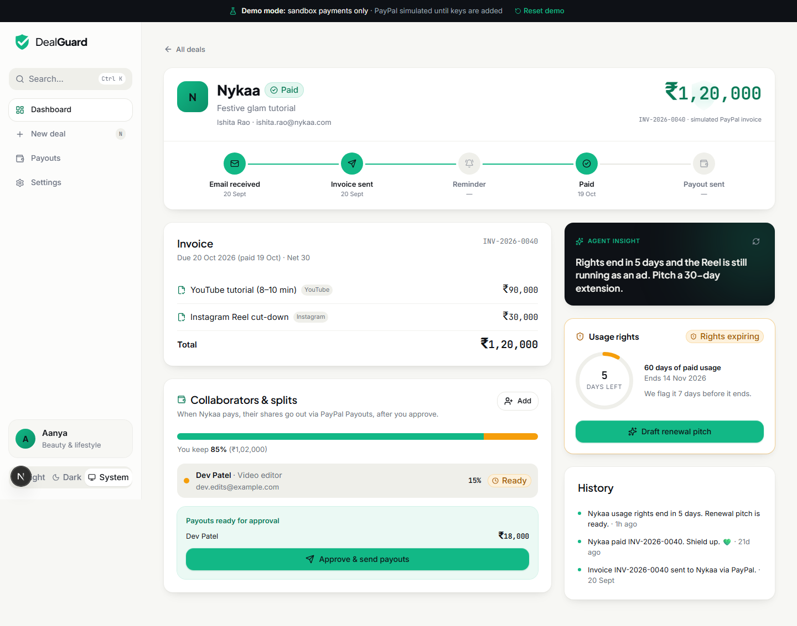
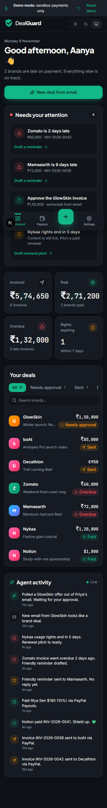
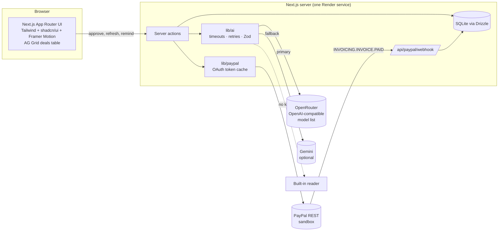

# DealGuard 🛡️

**Every deal, guarded.**
Get paid for every post, without the awkward follow-ups.

DealGuard is an AI agent for small creators (10K–200K followers) who manage their own brand deals. Paste a brand email → the AI extracts the deal → you approve → a PayPal invoice goes out → DealGuard tracks payment, chases late payers, pays your collaborators and guards your usage rights.

> Built for the PayPal AI Hackathon 2026. Payments run on the **PayPal sandbox**; no real money moves.

## Built during the hackathon

DealGuard began as an earlier prototype: a local tool that read Gmail and extracted deal terms with an on-device model. During the hackathon it was rebuilt around PayPal:

- **The PayPal integration is new**: Invoicing v2 (create, send, status, reminders), Payouts for collaborator splits, and webhook verification for `INVOICING.INVOICE.PAID`.
- **The agent is new**: the chase agent (friendly → firm → final reminders sent through PayPal), the usage-rights guard with renewal pitches, and the per-deal insight.
- **The product is new**: the approval-first flow with an invoice preview, the dashboard, onboarding, per-visitor demo mode, and the full design system (light and dark mode, mobile).



---

## The problem

Small creators are their own finance team. They deliver the content, then spend weeks chasing brands for payment over email, and they lose track of when a brand's right to reuse their content (usage rights) expires, so brands keep running their videos as ads for free.

## Who it's for

Independent creators with 10K–200K followers who negotiate brand deals themselves: no manager, no agency, no accountant.

## Features

| | |
|---|---|
| **Deal intake** | Paste any brand email, or pick from a demo inbox of 5 realistic offers. |
| **AI extraction** | Brand, contact, deliverables, fee + currency, due date, payment terms and usage rights animate in field by field, each with a confidence hint. The matching words light up in the email so you can see where every value came from. |
| **Approval first** | The agent never acts on its own. You see the exact PayPal invoice before anything is sent. |
| **PayPal invoice** | One line item per deliverable, sent through Invoicing API v2. |
| **Payment tracking** | Draft → sent → paid / overdue, through the PayPal webhook plus a "Refresh status" button that polls PayPal. |
| **Chase agent** | Friendly → firm → final reminders, with the AI picking the right tone for how late the brand is. You approve each one; it goes out through PayPal's reminder endpoint. |
| **Usage-rights guard** | Countdown ring per deal, flags rights expiring within 7 days, and drafts a paid renewal pitch. |
| **Collaborator payouts** | Add editors/designers with % splits. When the brand pays, DealGuard proposes payouts; on approval they're sent with PayPal Payouts. |
| **Agent insight** | One specific next step per deal ("Usually pays 10–14 days late. Send a firm reminder now."). |
| **Demo mode** | "Try the live demo" opens your own seeded workspace with deals in every state. Reset any time. |
| **Polish** | Light + dark mode, mobile bottom nav, command palette (Ctrl/⌘ K), skeleton loaders, toasts, a confetti + shield pulse when a brand pays, `prefers-reduced-motion` respected. |

## Screenshots

| Dashboard | New deal |
|---|---|
|  |  |
| **Deal (paid)** | **Dark mode, mobile** |
|  |  |

## Architecture



All PayPal and AI calls happen on the server. Keys are read from environment variables and are never logged or sent to the browser.

## What is real in the hosted demo

| Step | Hosted demo |
|---|---|
| Invoices for **USD / EUR** deals | **Real PayPal sandbox** (Invoicing API v2): created, sent and tracked. |
| Payment reminders | **Real**: sent through PayPal's invoice reminder endpoint. |
| Payment status | **Real**: "Refresh status" reads the invoice from PayPal. |
| Invoices for **INR** deals | Simulated and labelled: PayPal can't invoice in INR from a US sandbox account. |
| Seeded sample deals, "Simulate brand payment" | Simulated and labelled, so judges can see every state in seconds. |
| Collaborator payouts | The code calls PayPal Payouts, but Payouts isn't enabled on this sandbox account, so the step runs as a labelled simulation. |

## PayPal APIs used, and why

| API | Endpoint | Why |
|---|---|---|
| OAuth 2.0 | `POST /v1/oauth2/token` | Client-credentials token, cached until shortly before expiry. |
| Invoicing v2 | `POST /v2/invoicing/generate-next-invoice-number` | Proper sequential invoice numbers. |
| | `POST /v2/invoicing/invoices` | Creates the draft with one item per deliverable, the due date and terms. |
| | `POST /v2/invoicing/invoices/{id}/send` | Emails the invoice to the brand, who pays with PayPal or card. |
| | `GET /v2/invoicing/invoices/{id}` | "Refresh status": works locally without a public webhook URL. |
| | `POST /v2/invoicing/invoices/{id}/remind` | Sends the chase agent's approved reminder in PayPal's own thread. |
| Payouts v1 | `POST /v1/payments/payouts` | Pays collaborators their % share after the brand pays. |
| Webhooks | `POST /v1/notifications/verify-webhook-signature` | Verifies `INVOICING.INVOICE.PAID` events before marking a deal paid. |

Errors are turned into plain-English messages in the UI (e.g. *"The brand's email address looks invalid. Fix it and try again."*). 429 and 5xx responses are retried with backoff.

**So the demo never breaks for a judge:** if PayPal itself refuses a call (a sandbox app without a permission, an unsupported currency, an outage or a network error), that step finishes in a clearly labelled **simulation**: IDs start with `SIM-` and the UI says "(simulated)". Problems the creator can fix, like an invalid email address, still show as errors.

## How AI is used

AI does real work in four jobs (`src/lib/ai`):

1. **Extract deal terms** from a messy brand email into strict JSON (validated with Zod).
2. **Draft escalating payment reminders** (friendly → firm → final) using the deal facts and the creator's tone preference.
3. **Draft usage-rights renewal pitches** with a suggested extension fee.
4. **Write a one-line agent insight** per deal.

**Models used:**
- **OpenRouter** (OpenAI-compatible API, called with the OpenAI SDK). `AI_MODEL` takes a list that is tried in order. The hosted demo uses `nvidia/nemotron-3.5-super-vl:free`, then `openrouter/free`. Any OpenAI-compatible provider works, Groq included, by changing `AI_BASE_URL`.
- **Gemini** (Google GenAI SDK) is an optional extra fallback.
- **A built-in rules-based reader and template writer** answer when no keys are set, or when every model is unavailable.

**Reliability:**
- **Timeouts and retries:** every call has a timeout. 5xx and network errors are retried once with exponential backoff and jitter. A 429 ("model busy") skips straight to the next model.
- **Time budget:** each AI task has 25 seconds in total. After that the built-in reader answers, so nobody waits forever.
- **JSON checks:** replies are validated with Zod. An invalid reply gets one repair prompt before the next model is tried. If line-item prices clearly don't add up to the fee, the fee is spread across the lines.
- **Logging:** logs record which provider and model answered, never keys or prompts.
- **Transparency:** the UI says who read the email ("Read by OpenRouter / Gemini / Built-in reader").

The AI never changes a deal or sends anything by itself. Every action waits for the creator to click Approve.

## Run it locally

Requirements: Node.js 22+ (tested on 24).

```bash
npm install
cp .env.example .env     # then fill in the keys (all optional for the demo)
npm run dev
```

Open http://localhost:3000 and click **Try the live demo**.

With no keys, DealGuard runs fully in demo mode: the built-in reader extracts deals, and PayPal calls are **simulated** (IDs start with `SIM-`, and the UI labels them). Add keys to switch to the real sandbox and AI.

### Environment variables

| Name | What |
|---|---|
| `PAYPAL_CLIENT_ID`, `PAYPAL_CLIENT_SECRET` | Sandbox REST app credentials (developer.paypal.com → Apps & Credentials → Sandbox). |
| `PAYPAL_BASE_URL` | `https://api-m.sandbox.paypal.com` |
| `PAYPAL_BUSINESS_EMAIL` | The sandbox **business** account email (invoices are sent from it). |
| `PAYPAL_WEBHOOK_ID` | Optional. ID of the webhook you register for `INVOICING.INVOICE.PAID`. |
| `AI_API_KEY` | OpenRouter API key (or any OpenAI-compatible provider's key). |
| `AI_BASE_URL` | `https://openrouter.ai/api/v1` (Groq: `https://api.groq.com/openai/v1`). |
| `AI_MODEL` | One model or a comma-separated list, tried in order, e.g. `nvidia/nemotron-3.5-super-vl:free,openrouter/free`. |
| `GEMINI_API_KEY`, `GEMINI_MODEL` | Optional Gemini fallback key and model name. |
| `DATA_DIR` | Optional. Folder for the SQLite file (default `./data`). |

### Useful scripts

| Command | What |
|---|---|
| `npm run dev` | Start locally on port 3000. |
| `npm run lint` / `npm run typecheck` | ESLint and TypeScript, both clean. |
| `node scripts/e2e.mjs` | Clicks through the whole core flow in a headless browser. |
| `node scripts/screenshots.mjs / /demo ...` | Screenshots each route in light/dark at mobile and desktop sizes. |

## Demo walkthrough (30 seconds)

1. Click **Try the live demo**. You land on a dashboard with deals in every state.
2. **Needs your attention** shows two late brands, one deal to approve and usage rights about to expire.
3. Click **New deal from email** → pick **Notion** (a USD deal) in the demo inbox → **Extract deal with AI**. Watch the fields fill in (free AI models can take 10–40 seconds).
4. **Review invoice** → **Approve & send**. A real PayPal sandbox invoice goes out and you land on the deal.
5. Click **Simulate brand payment** (or pay as the sandbox buyer and click **Refresh status**). Watch the confetti, then **Approve & send payouts**.
6. Open **Mamaearth** (9 days late) → the chase agent suggests a **firm** reminder → **Draft** → **Approve & send**.
7. Open **Nykaa** → usage rights end in 5 days → **Draft renewal pitch**.

See [DEMO_SCRIPT.md](DEMO_SCRIPT.md) for the 2:30 video script.

## Deploy

See [docs/MANUAL_STEPS.md](docs/MANUAL_STEPS.md) for Render and PayPal webhook setup. `render.yaml` deploys it as one Node web service.

## Tech

Next.js 15 (App Router) · TypeScript · Tailwind CSS 4 · shadcn/ui (customised) · Framer Motion · lucide-react · AG Grid Community · SQLite + Drizzle ORM · OpenAI SDK (OpenRouter) · Google GenAI SDK (Gemini) · Zod · Playwright

## License

[MIT](LICENSE)
